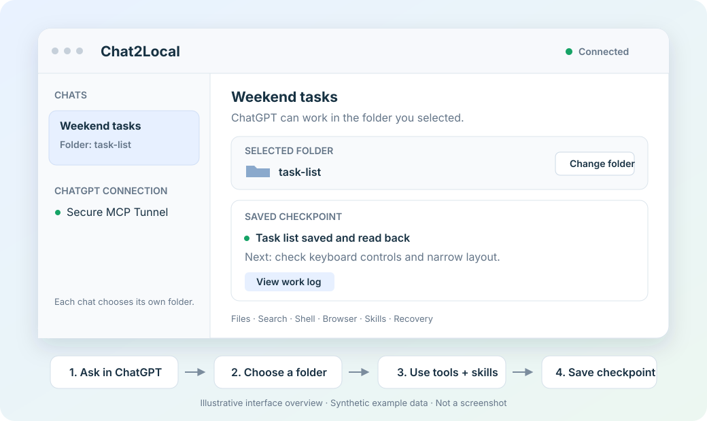

# Chat2Local

**Give ordinary ChatGPT chats tools for your local projects.**

Choose a folder in the Chat2Local Mac app. Your chat can then read and edit files, run development commands, use a separate browser, and read relevant skills. Several chats can work in the same folder, with a separate checkpoint and work history for each chat.

Chat2Local **0.3.0 is a macOS developer preview** under the [MIT license](LICENSE). It requires ChatGPT developer-mode and Secure MCP Tunnel access. The npm installer has been tested locally but is **not published**. Mac preview builds use ad hoc signing and are **not notarized**. See [installation](docs/INSTALL.md) and [release verification](docs/RELEASE_CHECK.md).



*Interface illustration with synthetic example data; not a screenshot.*

## Quick start

### 1. Build and open the Mac app

Requires macOS 14+, Node.js 24+, npm, and Swift 6.2 with a compatible macOS SDK. Brave at `/Applications/Brave Browser.app` is needed only for browser tools.

```sh
npm ci
npm run robustness
npm run macos:package
open "dist/Chat2Local.app"
```

The app includes Node, its local tool service, and a pinned official OpenAI tunnel client with the required notices. A source build does not need a separate tunnel-client download. Closing the window leaves the app running; choose **Quit** in its menu to stop it.

### 2. Connect ChatGPT

See the [visual connection guide](docs/CONNECTION_SCREENS.md) for OpenAI's sanitized tunnel and ChatGPT setup screenshots, plus a diagram of the runtime-key field.

Create a Secure MCP Tunnel in your OpenAI Platform organization, associate it with your ChatGPT workspace, and obtain a runtime key authorized to use it. Enter the tunnel ID and runtime key in Chat2Local's **ChatGPT connection** settings, then choose **Save and connect**.

In ChatGPT, enable developer mode if your account supports it, create a tunnel connection, and select it in a chat. The [installation guide](docs/INSTALL.md) explains these steps and the permissions they require. The runtime key is used for tunnel transport; Chat2Local does not use it for model-inference API calls.

### 3. Choose a folder and ask for real work

Copy `examples/hello-local-dev` somewhere convenient, including its hidden `.agents` directory. In an ordinary ChatGPT chat with the connection selected, send:

> Use Chat2Local to build the small task list described in my local folder. Make it easy to use on my phone and laptop.

The chat returns a setup code such as `LD-1234ABCD`. Open Chat2Local, match that code, and choose your copy of the example folder. Reply **connected** in ChatGPT.

The assistant can now read `briefing.md`, check the project's skill, save a checkpoint, and create `index.html`. Open the file from Finder and try adding and completing tasks. A downloaded ChatGPT attachment alone does not prove a local file was saved; check the selected folder. See the [demo walkthrough](docs/DEMO.md).

Each new chat chooses its own folder. A chat appears in the app after its first Chat2Local tool call; opening a conversation does not register it. No conversation address or exact chat title is needed.

## Tools and skills

| Capability | What the chat can do |
| --- | --- |
| Files and search | Read, write, edit, list, and search inside its selected folder. |
| Development commands | Run bounded shell commands for builds and validation. |
| Skills | Discover and read installed Codex, agents, plugin, and project guides. |
| Browser and web | Use a separate Brave profile per chat, inspect pages, take screenshots, and read known web pages. |
| Images | Import an image explicitly supplied by the chat. |
| Recovery | Read private work history and save task checkpoints. |

The service requires a skill catalog check before file changes or commands after a folder selection or service restart. It also requires a checkpoint before actions that may have effects. Relevant skill text is read on demand; Chat2Local does not bundle your personal installed skills into a release. A recorded skill read or checkpoint cannot prove the model followed its instructions.

The [15-tool reference](docs/TOOLS.md) keeps the compatible `local_dev_*` action identifiers. The bundled workflow is in `plugin/local-dev`; [installation](docs/INSTALL.md#optional-install-the-bundled-workflow-plugin) explains when to install it.

## Recover interrupted work

Open **View work log** on a chat card to review the last checkpoint and recorded actions. Ask the chat to read that history and inspect actual files before retrying a failed or uncertain action. Direct text writes use atomic replacement to resist incomplete saves.

To continue in a new chat, deliberately copy a recovery summary and paste it yourself, then choose a folder for that chat. The log does not back up the project, roll back effects, replay commands, or wake chats. Read the [recovery guide](docs/WORK_RECOVERY.md) for limits and retention.

## Privacy and access

- You select one folder per chat in the native app; model tools cannot select it. File tools reject paths and symlinks that escape it.
- Requested file contents, skill text, page content, screenshots, and command results can be sent to ChatGPT. The whole folder is not uploaded automatically.
- Browser profiles are separate from your personal cookies. Shell commands can execute project code and use the network; they are not a virtual machine.
- Connections, checkpoints, and history stay in the private `~/.local-dev/chat-folders.sqlite` database. Tunnel credentials use macOS Keychain. Source and installer packages exclude this private state.
- Chats sharing a folder share its files. Their folder grants and recovery histories remain separate; coordinate overlapping edits.

See [security and privacy](SECURITY.md) before connecting sensitive projects. The local service requires trusted per-chat MCP metadata and authenticated loopback access. These controls do not isolate it from other software running as the same macOS user.

## Installation and release status

The installer source lives in `packages/installer`. Its `chat2local` command installs the prebuilt app into `~/Applications` after checking the download, bundle, version, architecture, and signature. Installing a prebuilt app requires Node.js 20+ and does not require Swift or Xcode.

The npm package is **unpublished**. `npx <published-package-name> install` is a future command template, not an available registry command. Hosted assets and a public package name need a selected release destination. Public Mac distribution also requires Developer ID signing, notarization, and first-launch checks on another Mac. The installer does not bypass Gatekeeper or install certificates.

For building and checking releases, see [npm release preparation](docs/NPM_RELEASE.md). For ordinary setup and connection failures, see [troubleshooting](TROUBLESHOOTING.md).

## Contribute or share

```sh
npm run robustness
npm run release:check
npm run release:export
```

The source export uses an explicit inventory, secret-pattern scan, and file hashes. Dependencies, built apps, private credentials, browser profiles, and runtime state are excluded. Review the inventory; the scan is not a comprehensive security audit. Share the checked export rather than the whole development folder.

Read [contributing](CONTRIBUTING.md) and [what changed](CHANGELOG.md). GitHub sharing is separate from ChatGPT's public plugin directory: this preview uses a private developer-mode connection. [OpenAI Secure MCP Tunnel documentation](https://developers.openai.com/api/docs/guides/secure-mcp-tunnels).
