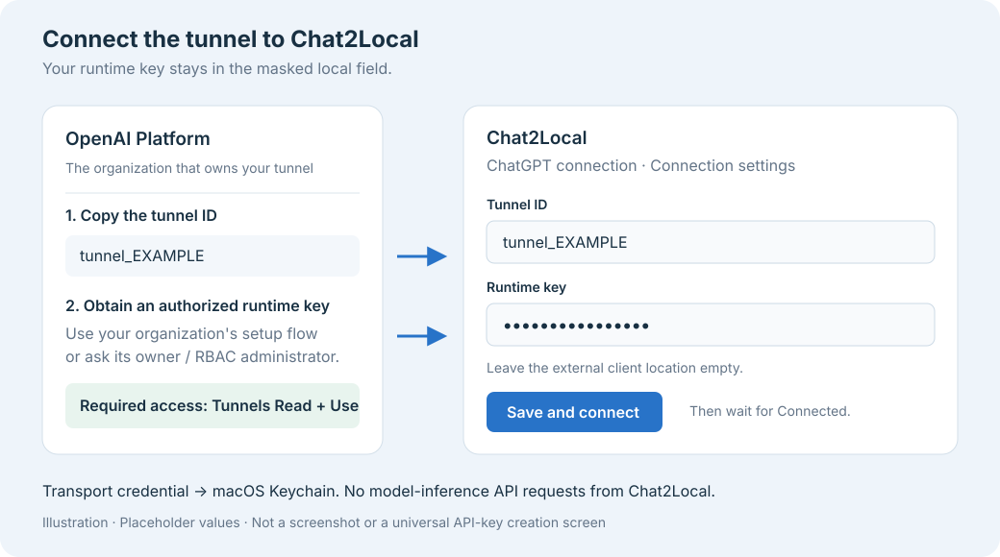

# Connect Chat2Local: visual guide

Follow these screens after building or installing Chat2Local. The two OpenAI screenshots below are sanitized examples from OpenAI's documentation, loaded from its website. The runtime-key diagram uses dummy data. No image shows the maintainer's account or credentials.

## 1. OpenAI Platform: tunnel settings

Open [Platform tunnel settings](https://platform.openai.com/settings/organization/tunnels). Select the organization that owns your tunnel, create the tunnel, copy its ID, and associate it with the ChatGPT workspace you will use.

*OpenAI's sanitized example. Source: [Secure MCP Tunnel guide](https://developers.openai.com/api/docs/guides/secure-mcp-tunnels). The screenshot is hosted by OpenAI; labels and layout may change.*

## 2. Runtime API key: obtain it and save it locally

Obtain a runtime API key authorized for the tunnel's organization. Follow the credential setup available in your tunnel settings, or ask the organization owner or RBAC administrator. Tunnel creation requires **Tunnels Read + Manage**; running the client requires **Read + Use**. [Official permissions](https://developers.openai.com/api/docs/guides/rbac).

The general [API-key dashboard](https://platform.openai.com/api-keys) is a reference entry point. OpenAI's tunnel guide does not specify a universal key-creation screen or guarantee that an arbitrary project key can use a tunnel. Use an authorized runtime key for your organization.

*Illustration, not an OpenAI Platform or Chat2Local screenshot. All values are placeholders.*

In Chat2Local, expand **ChatGPT connection → Connection settings**:

- **Tunnel ID:** paste the tunnel ID.
- **Runtime key:** paste the authorized key into the masked field.
- **Tunnel client:** leave the optional external client location empty to use the bundled client.
- Choose **Save and connect** and wait for **Connected**.

Chat2Local stores the runtime key in macOS Keychain and uses it for tunnel transport. It does not use it for model-inference API requests. Its separate local API token is managed automatically. Paste neither credential into a chat, GitHub issue, or screenshot.

## 3. ChatGPT: add the tunnel connection

Enable **Settings → Security and login → Developer mode**, if your account allows it. Open **Plugins → +**, name the connection **Chat2Local**, and choose **Tunnel** under **Connection**. Select your tunnel or enter its ID, create the connection, and review the discovered tools. [Official connection instructions](https://developers.openai.com/plugins/deploy/connect-chatgpt).

*OpenAI's sanitized example, from its [Secure MCP Tunnel guide](https://developers.openai.com/api/docs/guides/secure-mcp-tunnels). Your tunnel should be connected in Chat2Local during discovery.*

## 4. Select Chat2Local in a chat and choose a folder

Select the connection from the chat's tools menu, then send **Use Chat2Local for this project**. Match the returned `LD-` setup code in the Mac app, select a folder, and reply **connected** in the chat.

Check that the connection exposes all **15 tools**, including `local_dev_work_log`. A successful setup should let that chat confirm its folder, list skills, and save a checkpoint before changing files. See the [complete installation guide](INSTALL.md) or try the [small demo](DEMO.md).

If the official screenshots do not load, follow their source links; the written steps above remain available in the source package.
